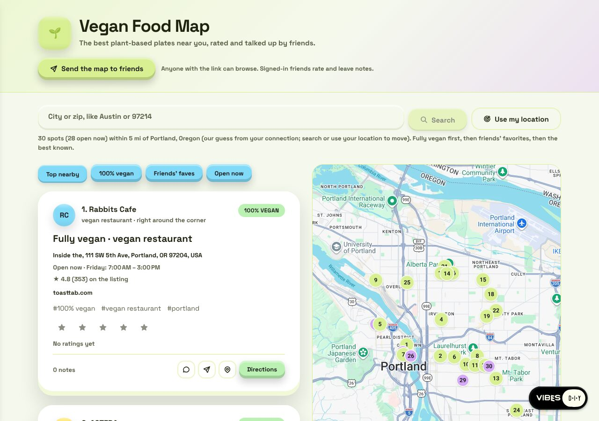
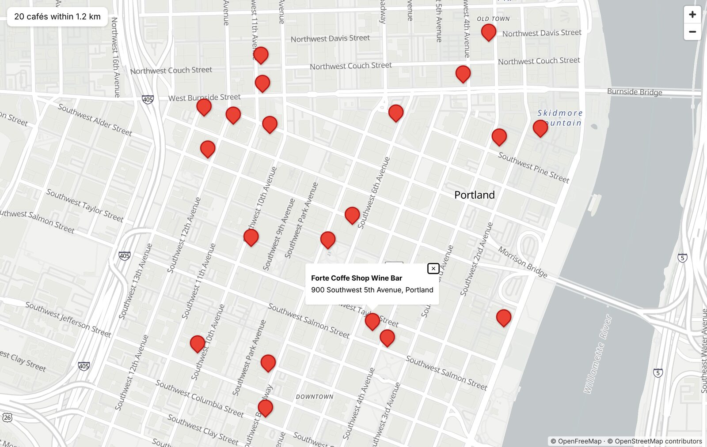

# google-maps-shim

**Write ordinary Google Maps JavaScript API code. With a Google key it runs on
Google. Without one it runs on a free map: MapLibre GL on OpenFreeMap tiles,
with places from OpenStreetMap.**

It is a drop-in for [`@googlemaps/js-api-loader`](https://github.com/googlemaps/js-api-loader).
Point that specifier at this library and the same `importLibrary("maps")`,
`AdvancedMarkerElement` and `Place.searchNearby` code draws a map either way.
It is what every map app on [Vibes DIY](https://vibes.diy) runs on.

| On Google (a real key)                                                                                                                         | On the free map (no key)                                                                                                                                      |
| ---------------------------------------------------------------------------------------------------------------------------------------------- | ------------------------------------------------------------------------------------------------------------------------------------------------------------- |
|  |  |
| [Vegan Food Map](https://vibes.diy/vibe/jchris/vegan-map-product), a Vibes DIY app, in Google mode.                                            | [`examples/index.html`](examples/index.html): real OpenStreetMap cafés from `Place.searchNearby`, no key, no server.                                          |

Read the story behind it: [Every map app comes with a free map](https://good.vibes.diy/blog/every-map-app-comes-with-a-free-map).

## Use it on any page

No build step: an import map points Google's loader name at this file.

```html
<script type="importmap">
  {
    "imports": {
      "@googlemaps/js-api-loader": "https://cdn.jsdelivr.net/gh/VibesDIY/google-maps-shim@main/dist/google-maps-shim.js"
    }
  }
</script>
<div id="map" style="height: 400px"></div>
<script type="module">
  import { setOptions, importLibrary } from "@googlemaps/js-api-loader";

  setOptions({ v: "weekly" }); // add key: "AIza…" to run on Google instead
  const { Map } = await importLibrary("maps");
  const { AdvancedMarkerElement } = await importLibrary("marker");
  const { Place } = await importLibrary("places");

  const center = { lat: 45.5197, lng: -122.6786 };
  // A Map ID is what Google's AdvancedMarkerElement needs; the free map ignores it.
  const map = new Map(document.getElementById("map"), { center, zoom: 15, mapId: "DEMO_MAP_ID" });
  const { places } = await Place.searchNearby({
    fields: ["displayName", "location"],
    locationRestriction: { center, radius: 1200 },
    includedPrimaryTypes: ["cafe"],
  });
  for (const p of places) new AdvancedMarkerElement({ map, position: p.location, title: p.displayName });
</script>
```

With a bundler, install from GitHub and alias the name:

```sh
npm install github:VibesDIY/google-maps-shim
```

```js
// vite.config.js
export default { resolve: { alias: { "@googlemaps/js-api-loader": "@vibes.diy/google-maps-shim" } } };
```

TypeScript: the package ships declarations, and `importLibrary("maps")` and its
siblings are typed with Google's own `google.maps` types (`@types/google.maps`
comes along as a dependency), so editor help reads like Google's.

## How it picks

- **A real Google key** (`setOptions({ key })` or `new Loader({ apiKey })`, shaped
  like `AIza…`): every call goes to Google's own loader. Your key, your bill,
  your code unchanged.
- **No key, or a placeholder like `"YOUR_API_KEY"`**: the free map. MapLibre GL
  (bundled, about 340 KB gzipped, no other request at load) draws OpenFreeMap's
  positron style, or its dark style when the page prefers dark. Place searches
  go to OpenStreetMap through the public [Overpass](https://overpass-api.de)
  mirrors, straight from the browser.

Place searches can go somewhere steadier:

```js
import { configureFreeMaps } from "@googlemaps/js-api-loader"; // the shim, under Google's name

configureFreeMaps({ geoapifyKey: "…" }); // Geoapify's hosted OpenStreetMap, free tier
// or answer them yourself, from your own server or a cache:
configureFreeMaps({
  search: async (query) => ({
    mode: "free",
    source: "my-server",
    attribution: "© OpenStreetMap contributors",
    places: await myServer.searchPlaces(query), // [{ id, displayName, location: { lat, lng }, types }, …]
  }),
});
```

A custom `search` gets one query (`search`, `center`, `radius`, `includedTypes`,
`textQuery`, …) and resolves to `{ mode, source, attribution, places }`, each
place in Google Places (New) field names; a rejected promise becomes the
search's error. The types are exported (`FreeMapsSearch`, `PlacesQueryWire`,
`PlacesResultWire`, `PlaceWire`).

## What the free map covers

| library  | members                                                                                                                                            |
| -------- | -------------------------------------------------------------------------------------------------------------------------------------------------- |
| `core`   | `LatLng`, `LatLngBounds` (`extend`, `getCenter`, `contains`, `union`, …), `event`                                                                  |
| `maps`   | `Map` (`center`, `zoom`, `fitBounds`, `panTo`, `setCenter`, `setZoom`, `getZoom`, `getCenter`, `getBounds`, `addListener`), `InfoWindow`, `Marker` |
| `marker` | `AdvancedMarkerElement` (`map`, `position`, `content`, `title`, click), `PinElement`                                                               |
| `places` | `Place.searchNearby`, `Place.searchByText`, `fetchFields` for the fields the search loaded                                                         |

Place types the free search knows: `restaurant`, `vegan_restaurant`,
`vegetarian_restaurant`, `fast_food_restaurant`, `cafe`, `coffee_shop`,
`bakery`, `ice_cream_shop`, `bar`, `park`, `dog_park`, `playground`, `museum`,
`tourist_attraction`, `library`, `book_store`, `supermarket`, `grocery_store`,
`pharmacy` and `gym` (`FREE_PLACE_TYPES` maps each to OpenStreetMap tags; one
row adds one more). `searchByText` reads diet words too: "vegan bakery" finds
bakeries tagged `diet:vegan`.

A call outside the subset throws an Error that names it and says "not
available in the free map": `importLibrary("routes")`, `google.maps.Polyline`,
`map.setTilt`, an `isOpenNow` filter. Map options it does not draw, such as
`styles` or `tilt`, are ignored. Fields OpenStreetMap does not carry
(`rating`, `photos`, …) read `null`, the way Google answers for a place without
them. Place ids look like `osm:node/123`.

## Where it lives

This repo is published automatically from the Vibes DIY monorepo on every
change to the library there. That copy is the one we edit: the Vibes DIY
platform serves it to every map app, and the platform's own place search runs
the same `src/osm-places.ts`. Issues and pull requests are welcome here. A
merged pull request is carried into the monorepo by hand, because the next
publish replaces this tree.

`standalone.ts` is this library's entry. `index.ts` is the Vibes DIY entry,
where the platform picks Google or free per page and meters Google's bill.

## License

Apache-2.0. The bundle includes MapLibre GL JS 6.16.0 (BSD-3-Clause; its full
licence is the exported `licenses` string). Map tiles: [OpenFreeMap](https://openfreemap.org).
Map data and places © [OpenStreetMap contributors](https://www.openstreetmap.org/copyright) (ODbL).
